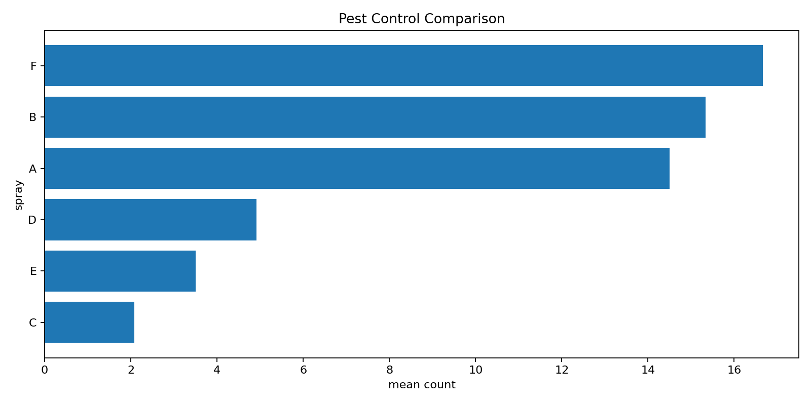

# Pest Control Comparison — executed results

## Decision question
How do observed insect counts differ by spray?

## Evidence
The largest observed mean count is 16.667 for F. This ranking is descriptive, not a recommendation.

Raw rows: 72. Rows used: 72. Excluded for missing/nonfinite required values or invalid denominator: 0.

## Method
Complete-case descriptive comparison of count by spray; show group counts, mean, minimum and maximum.

## Interpretation and limitations
Lower counts indicate better observed control; experimental context limits transfer. No causal inference, significance claim or production deployment is implied. Missing values are not imputed; identical rows are retained. Small or repeated samples limit uncertainty interpretation.

## Recommended next decision
Compare safety, cost and repeatability before choosing a treatment.

## Reproducibility
Source and exact downloaded-byte SHA256 are recorded in run_manifest.json. SQL results are in answer.csv and analysis.sqlite. Review quality_audit.csv before interpretation.
